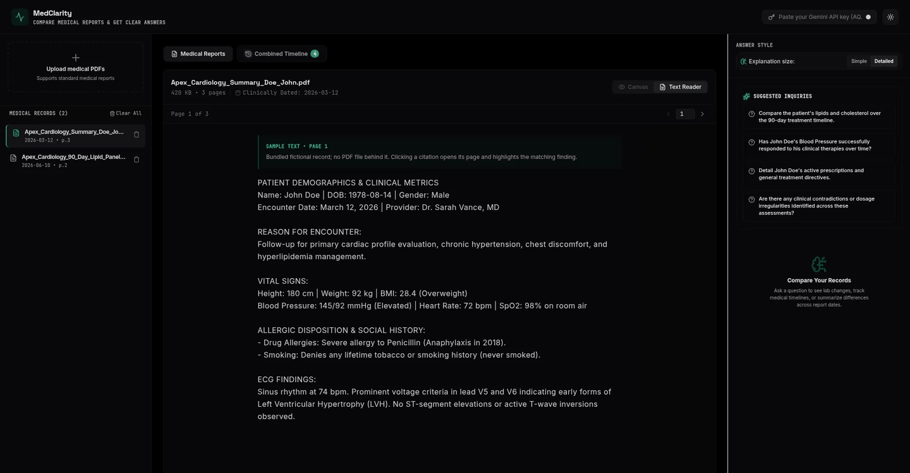

<div align="center">

# MedClarity

**Medical PDFs, minus the detective work.**

[](https://github.com/sonawaneutkarsh/MedClarity/actions/workflows/ci.yml)

Upload several medical PDFs, ask a question, and get one answer with page-level citations you can click to check, plus a combined timeline of events across the documents.

[Live demo](https://medclarity-one.vercel.app) · bring your own Gemini API key

</div>



*The bundled sample records (fictional patient) loaded in the live demo. Asking a question needs your own Gemini key.*

---

## What it does

- **Citations you can check.** Answers carry inline `[Document Name, p.N]` references. Each one is checked against the documents you loaded: a citation that matches a real document and page becomes a button that opens that page and highlights the finding; one that does not (unknown document, ambiguous name, page out of range) is shown struck through. This makes the evidence inspectable. It does not make the model correct.
- **Disagreements and trends called out.** The model is asked to flag conflicts between documents (doses, allergies, history) and changes over time. These render as separate callouts above the rest of the answer.
- **Simple or Detailed answers.** Pick the reading level before you ask, or rewrite an existing answer at the other level.
- **Combined timeline.** Dated events (findings, treatments, lab results) are extracted per document and merged into one chronological view. If a report date was detected wrong, you can correct it; only events that inherited that date move.
- **PDFs stay in the browser.** PDF.js extracts text locally. Only the extracted text goes to the server proxy and on to Gemini, with your key.

> **Educational tool, not medical advice.** Discuss findings and treatment decisions with a qualified clinician.

---

## How it works

Answering a question is **one Gemini request**:

1. PDF.js extracts the text of every page in the browser.
2. The app sends the question plus the full extracted text of all loaded documents, labelled by document and page, to `/api/gemini`.
3. The proxy forwards it to Gemini with a JSON response schema. The model returns the answer (Markdown with inline citations), a list of page-level findings, and a short conflict summary.
4. The browser resolves each citation against the loaded documents and renders the answer. Under each answer, "How this answer was produced" shows the model that answered and how many documents and pages it read.

Other features make separate, smaller requests: timeline extraction and report-date detection (per uploaded document), suggested questions, the Simple/Detailed rewrite (from the findings already returned, without re-sending the documents), and one-sentence definitions when you select a term in an answer or page.

### Server proxy

`lib/gemini-server.ts` is shared by the Express server (`server.ts`) and the Vercel functions in `api/`:

- Tries models in order: `gemini-3.8-flash`, then `gemini-3.5-flash-lite`, then `gemini-2.5-flash`. Override with `GEMINI_MODELS`.
- On a rate-limit / quota error, waits for Google's `RetryInfo` delay (capped at 8 s) and retries once, then falls back to the next model.
- Checks keys with a `models.list` call (no generation quota used).
- Accepts pasted keys in common forms (`AIzaSy…`, `AQ.…`, `ya29.…`, or a whole `GEMINI_API_KEY="…"` line).
- Rejects requests over 1,000,000 characters (HTTP 413) and limits each client to 20 Gemini calls and 10 key checks per minute. The limiter is in memory, so on Vercel it applies per function instance.

There is no server-side key. Every request uses the key the user pasted, kept in `sessionStorage` for the browser session.

### Limitations

- All document text goes into one prompt. There is no chunking or retrieval, so very large document sets hit the size limit.
- No OCR: scanned PDFs without a text layer produce empty pages.
- Citation checking confirms that the document and page exist. It does not confirm that the page supports the claim.
- PDF.js is loaded from a CDN.
- The model list reflects Gemini availability in October 2026. Google limits `gemini-2.5-*` to existing users, so new keys rely on the first two models.

---

## Tech stack

| Layer | Technology |
|---|---|
| Frontend | React 19, TypeScript (strict), Vite 6, Tailwind CSS 4, react-markdown, Lucide icons |
| PDF parsing | PDF.js 3.4 in the browser (CDN) |
| AI | Google Gemini REST API via a server-side proxy |
| Server | Express (local dev and self-hosting), Vercel serverless functions |
| Tests / CI | Vitest, GitHub Actions |

---

## Getting started

**Prerequisites:** Node.js 22.12 or newer (CI uses Node 24) and npm.

```bash
npm ci
npm run dev        # Express + Vite on http://localhost:3000
```

Then either click **Load Sample Medical Files** or upload your own PDFs. To ask questions, paste a Gemini API key from [Google AI Studio](https://aistudio.google.com/apikey) into the header; the status dot turns green when Google accepts it.

Without a key you can load the sample records and browse the pages and the timeline, but you cannot ask questions.

---

## Scripts

| Script | Description |
|---|---|
| `npm run dev` | Express + Vite dev server (API proxy + HMR) |
| `npm test` | Run the Vitest suite (66 unit tests) |
| `npm run typecheck` | `tsc --noEmit` |
| `npm run build` | Build the frontend into `dist/` and bundle the server into `dist/server.cjs` |
| `npm start` | Serve the production build (`dist/` + `/api`) |
| `npm run clean` | Remove `dist/` |

CI ([`.github/workflows/ci.yml`](.github/workflows/ci.yml)) runs `npm ci`, typecheck, tests, and the production build on every push to `main` and every pull request.

### What the tests cover

66 Vitest unit tests, no network access:

- key normalization and placeholder rejection
- `RetryInfo` delay parsing, rate-limit detection, retry-then-fallback across models, error status mapping
- request validation (missing prompt, 413 size limit, unknown schema) and key verification
- answer JSON parsing and the fallback when the model returns plain text
- citation parsing and resolution against loaded documents and page counts
- Markdown rendering of answers, including struck-through unresolved citations and escaped HTML
- the timeline date correction and the per-client rate limiter

---

## Project structure

```
├── api/                    # Vercel functions: /api/gemini, /api/gemini/verify
├── lib/
│   ├── gemini-server.ts    # Gemini proxy: model fallback, retries, validation, key check
│   └── rate-limit.ts       # In-memory per-client rate limiter
├── server.ts               # Express server (dev middleware or static dist/ + /api)
├── src/
│   ├── lib/
│   │   ├── gemini.ts       # Client calls: answer, rewrite, timeline, suggestions, definitions
│   │   ├── answer.ts       # Pure helpers: answer parsing, citation resolution, date correction
│   │   └── pdfParser.ts    # PDF.js text extraction, report-date detection
│   ├── components/         # AnswerView, DocViewer, TimelineView, SuggestedQuestions, MedicalDictionaryPopup
│   ├── sampleData.ts       # Two fictional sample records
│   ├── App.tsx             # App shell and chat
│   └── types.ts
├── test/                   # Vitest suites
└── vercel.json
```

---

## Deployment

### Vercel

`vercel.json` builds with `vite build` and rewrites non-`/api` routes to `index.html`; the functions in `api/` serve the proxy.

```bash
npx vercel
```

### Self-hosted

```bash
npm ci
npm run build
npm start          # serves dist/ and /api on PORT (default 3000)
```

---

## Environment variables

| Variable | Required | Description |
|---|---|---|
| `PORT` | No | HTTP port for `npm run dev` / `npm start` (default `3000`) |
| `GEMINI_MODELS` | No | Comma-separated models to try in order (default `gemini-3.8-flash,gemini-3.5-flash-lite,gemini-2.5-flash`) |
| `NODE_ENV` | No | `production` serves `dist/`; anything else uses Vite middleware (`npm start` sets it) |
| `VERCEL` | No | Set by Vercel; skips the Express listener |

There is no Gemini key variable: users paste their own key in the app. See [`.env.example`](.env.example).

---

## License

MIT. See [LICENSE](LICENSE).
